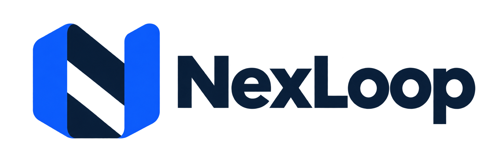

# NexLoop

<picture>
  
</picture>

English | [简体中文](README.zh-CN.md)

**Product page and interactive demo:** <https://www.zingnex.com/nexloop/>

NexLoop is an open-source **continuous-operations system** for enterprises. An owner sets long-term and stage goals (objectives and key results); Agents work inside governed Action boundaries defined by the ontology to keep understanding consumers, fulfil commitments, deliver value, and adjust plans based on real outcomes.

- Goals, ontology, relationships, memory and commitments persist in PostgreSQL; each piece of work is a short-lived, event-driven Run with a budget.
- Only governed EIOS Actions may change formal business objects or cause external effects. When an outcome is unknown, NexLoop queries and reconciles first; it never blindly resends.
- Reliable real-world actions come before consumer digital twins and simulated strategy selection.
- **This project is still exploratory**: it does not promise more revenue or payment, and interfaces and data structures will change. Agent autonomy is bounded by Action policy (governed Actions, role ceilings, contact restrictions, budgets), not by the model.
- Stack: Python 3.12 (FastAPI, psycopg, a vendored NEX-EIOS core), a Node 24 Agent Host (vendored Pi Durable), React 19, PostgreSQL 18 + pgvector, Valkey 8.1. The model is DeepSeek `deepseek-flash`; you bring your own model key. Without a key only the explicit deterministic test mode is available (for tests and demos; it is not a real-model acceptance). All example and test data in this repository is synthetic.

## Current status

*As of 2026-10-19 (`main` `5b7b5f57`); counts are read from [`planning/`](planning).*

- **Current stage: S5 close-out.** S0–S4 are done. All six S5 tasks (NX-032 to NX-037) are in progress; what each still needs is listed in the [S5 close-out gap list](docs/implementation/s5-closeout-gaps.md) (Chinese).
- **Numbers**: tasks 41 done / 6 in progress / 6 not started (53); acceptance tests 61 passed / 11 not run (72). Of the 11, 7 are S5 items and 4 belong to S6/S7, which are outside v0.1.
- **Deployed on a two-host stage**: a data host runs PostgreSQL and Valkey; an application host runs the API, the workers and the Agent Host. Every release is built by the local CI, signed and sealed before it is deployed. **The v0.1 final acceptance release (release 22, `47aa87b8`) is deployed**; until v0.1.0 only fixes are accepted. Backups (pgBackRest) and a restore drill have run on the stage.
- **Controlled real trial done (AT-071 passed)**: 36/36 controlled interactions with a real model and a real delivery action, reconciled through provider queries; total cost 1.59 CNY under a 100 CNY cap; zero unauthorised or wrong-recipient sends, zero contacts after refusal. The consumers were played by AI agents operated by the owner and are marked as such in the evidence.
- **Vector recall and candidate merging are enabled on the stage**: the recall index uses an embedding model whose calls are counted in the tenant's model budget, and the claim matcher merges candidates under a published merge configuration.
- **Real dispatch switches**: external effects need all three layers open: the deployment master switch, the tenant, and tenant+Action. On the stage the deployment layer stays on; the owner opens and closes the tenant and Action layers from the workbench, and they were closed again after the trial.
- **Demo**: [product page and interactive demo](https://www.zingnex.com/nexloop/).
- **Second-maintainer drill passed (AT-072)**: a maintainer designated by the owner (an AI agent that had not taken part in development) completed a release and a restore using the public documentation only.
- **Still open for v0.1**: switching the stage to the local Git queue and merge controller (AT-053, AT-054, scheduled 2026-10-20); a second restore drill with a replayed erasure (AT-050); checks on the final acceptance release (AT-055–058); the before/after inventories, the public pre-flight, the evidence pack and the tag. No tag or public release exists yet.

The owner's living plan — stage exits, critical path, pending decisions — is [planning/ROADMAP.md](planning/ROADMAP.md) (Chinese); authoritative task and acceptance status is in [`planning/`](planning). What is implemented and what is only planned is described in the [architecture guide](docs/ARCHITECTURE.md) (the frozen [handoff specification](docs/handoff/00_START_HERE.md) is the target design, not the implementation). Every change merged to `main` is in the [CHANGELOG](CHANGELOG.md). Known risks of v0.1 are in [docs/release/known-risks-v0.1.md](docs/release/known-risks-v0.1.md) (Chinese).

> Most project documents (architecture guide, ADRs, implementation notes, CHANGELOG) are written in Chinese; identifiers and public API names are in English.

## Quick start

You need Python 3.12 ([uv](https://docs.astral.sh/uv/)), Node 24.13.0 (`.nvmrc`), pnpm 10, and PostgreSQL 18 with pgvector (tests only create disposable instances and never connect to an existing database; set `NEXLOOP_TEST_PG_BIN` to the bin directory if it is not in the default location).

```bash
nvm use
```

```bash
uv sync --frozen && pnpm install --frozen-lockfile
```

Run one targeted test:

```bash
LC_ALL=en_US.UTF-8 LANG=en_US.UTF-8 PYTHONPATH=packages/eios-core/src:tests uv run --frozen pytest -q tests/test_bootstrap.py
```

Start a disposable workbench smoke environment on your machine (development machines only; synthetic data, loopback only, cleaned up on exit):

```bash
scripts/dev/workbench_smoke.sh
```

Full local CI (takes tens of minutes). Local CI is the release authority; GitHub Actions is not required:

```bash
bash scripts/ci/check
```

More (community test Compose, test conventions, contribution notes) is in [architecture guide §5](docs/ARCHITECTURE.md#5-开发者上手).

## Documentation

| Document | Contents |
|---|---|
| [docs/ARCHITECTURE.md](docs/ARCHITECTURE.md) | Business and technical architecture as implemented, module index, developer onboarding, known limitations |
| [docs/handoff/](docs/handoff/00_START_HERE.md) | Frozen handoff specification (PRD, target architecture, data model, deployment, acceptance); target design, not the implementation |
| [adr/](adr) | Architecture decisions from ADR-019 on (ADR-001–018 are in [16_ADR](docs/handoff/docs/16_ADR.md)) |
| [docs/implementation/](docs/implementation) | Per-task design notes, implementation notes and evidence |
| [CHANGELOG.md](CHANGELOG.md) | User-visible changes of every merge to `main` |
| [AGENTS.md](AGENTS.md) | Engineering contract |
| [docs/OPERATIONS.md](docs/OPERATIONS.md) | Operations handbook: entry points for deployment, doctor, alerts, backup/restore, release and rollback |
| [docs/CONNECTORS.md](docs/CONNECTORS.md) | Connector development guide: inbound channels, effect provider interface, signed commercial events, loopback and synthetic providers |
| [docs/EVALUATION.md](docs/EVALUATION.md) | Evaluation guide: deterministic regressions, opt-in real-model verification, merge calibration, load matrix |
| [GOVERNANCE.md](GOVERNANCE.md) | Maintainers, decision making, the ADR process, how to propose changes |
| [docs/release/public-release-checklist.md](docs/release/public-release-checklist.md) | Public release checklist |

## Contributing and security

How to contribute and the DCO sign-off are in [CONTRIBUTING.md](CONTRIBUTING.md); report vulnerabilities as described in [SECURITY.md](SECURITY.md); the code of conduct is [CODE_OF_CONDUCT.md](CODE_OF_CONDUCT.md).

This repository is public. Never commit `.env` files, keys, passwords, private network addresses or runtime data; model credentials belong only in the git-ignored `.env` or in private secret files. Run `uv run python scripts/check_publication.py --staged` before committing and `scripts/ci/prepush-scan.sh` before pushing.

## License

Our own code is licensed under [MIT](LICENSE) ([ADR-026](adr/ADR-026-license-mit.md), which supersedes the Apache-2.0 suggestion in handoff ADR-016). Third-party sources and licenses are listed in [NOTICE](NOTICE), [THIRD_PARTY_NOTICES.md](THIRD_PARTY_NOTICES.md), [licenses/](licenses) and [versions.lock.json](versions.lock.json).
