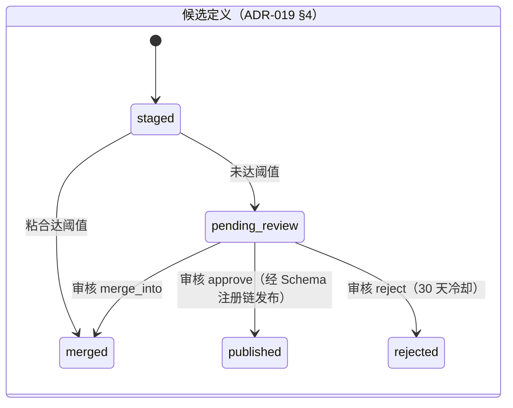
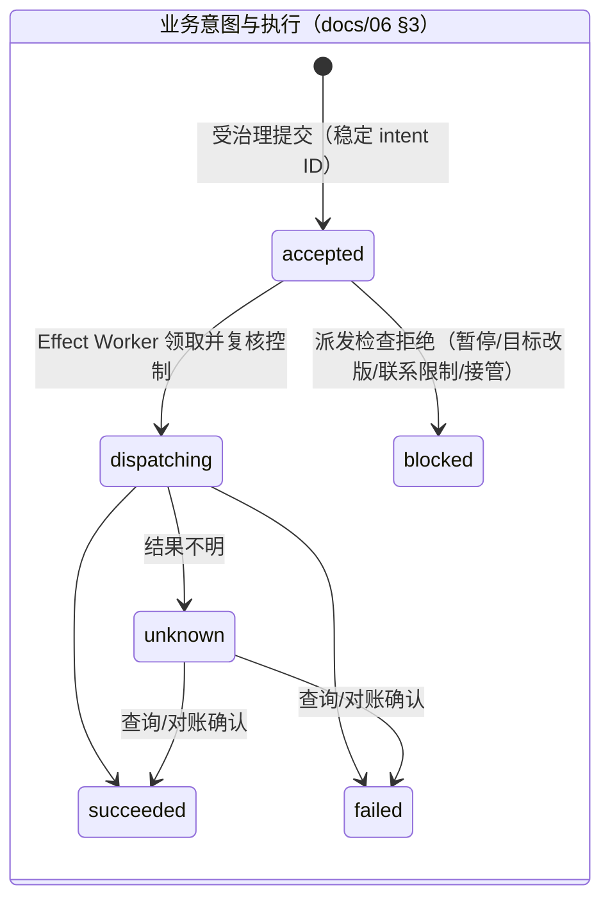
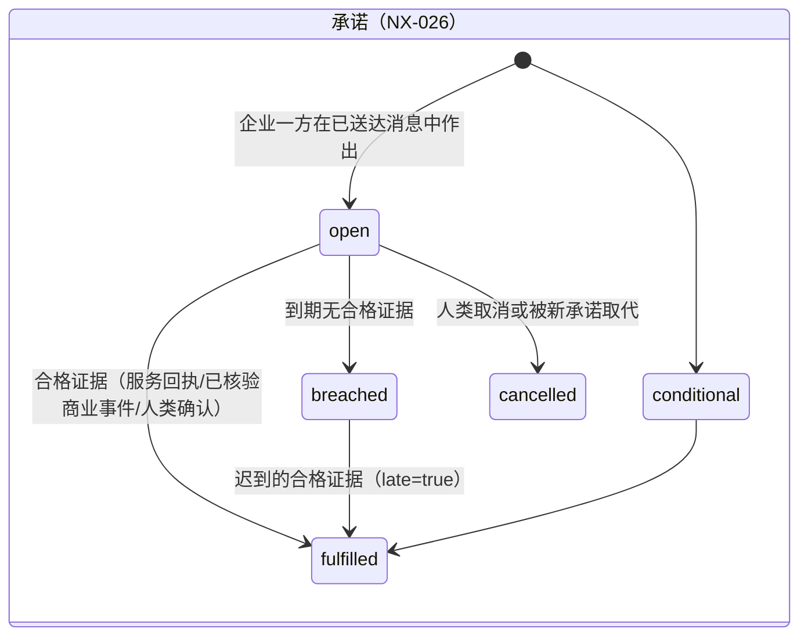
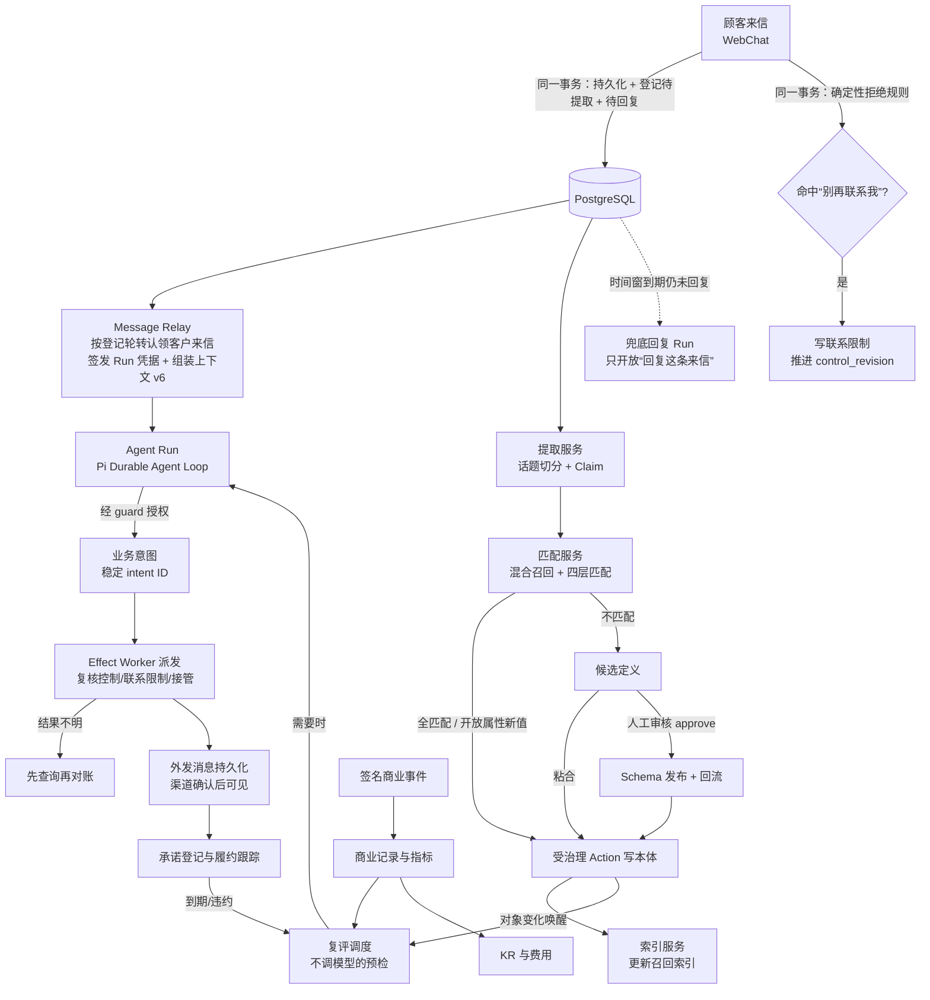
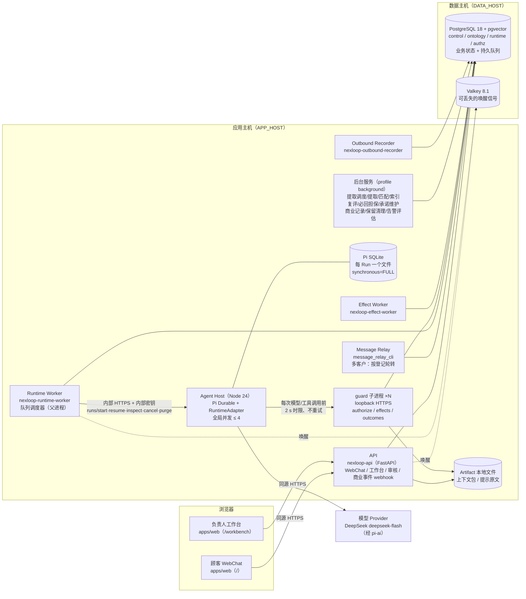
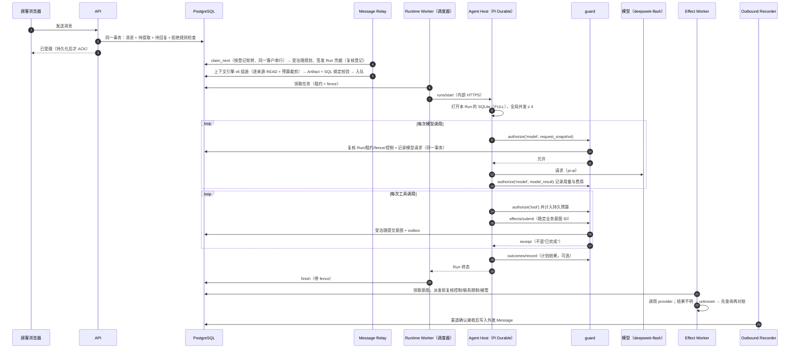
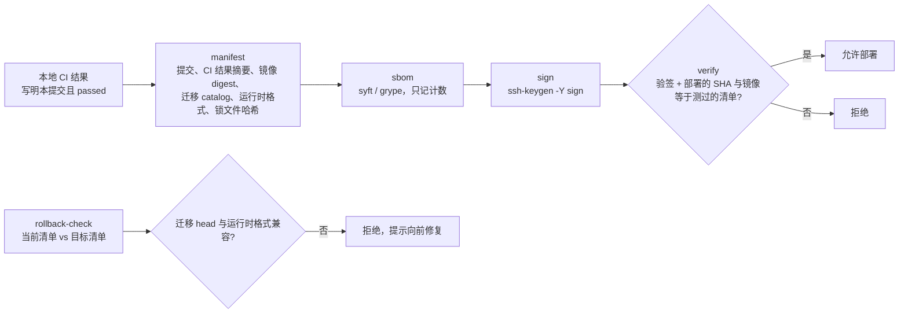

# NexLoop 架构说明（按当前实现）

> 面向外部开发者与贡献者。本文按 **当前已经实现并合入 `main` 的代码** 描述业务架构与技术架构，并指出与冻结目标规格（`docs/handoff/`）的差异。
>
> - 事实基线：`main` 提交 `414549b`（2026-10-11），迁移目录最高 `0144`，S0–S3 全部完成，S4 大部分完成（NX-030 只差备份年龄，NX-031 进行中），S5 只完成了 NX-034 的本地发布工具部分，部署尚未开始。
> - 主机一律用角色名：APP_HOST（应用主机）、DATA_HOST（数据主机）、CI 主机（规划中的 APP_HOST 兼作本地 CI 主机）。
> - 判断标准：代码、`adr/`、`planning/tasks.json` 与 `CHANGELOG.md` 优先；`docs/handoff/` 是目标设计，不等于已实现。
> - 文中标记：未加标注的内容都描述已在 `main` 中实现的代码；**【目标设计】** 指交接规格中的设计、尚未实现或只部分实现；**【待确认】** 指本文作者没能从代码或文档中核实的事项。
> - 状态会继续变化：任务与验收的实时状态以 [`planning/tasks.json`](../planning/tasks.json) 和 [`planning/acceptance-tests.json`](../planning/acceptance-tests.json) 为准，每次合入的用户可感知变化见 [`CHANGELOG.md`](../CHANGELOG.md)。

## 目录

1. [项目定位与核心理念](#1-项目定位与核心理念)
2. [业务架构](#2-业务架构)
3. [技术架构](#3-技术架构)
4. [仓库结构与模块索引](#4-仓库结构与模块索引)
5. [开发者上手](#5-开发者上手)
6. [当前状态与已知限制](#6-当前状态与已知限制)

---

## 1. 项目定位与核心理念

NexLoop 是面向企业的开源 **持续运营系统**。负责人给出长期目标与阶段目标（O / KR），Agent 在本体限定的 Action 边界内持续理解消费者、履行承诺、交付价值，并根据真实结果调整计划。目标是探索可持续的客户关系与持续付费，而不是最大化消息数量，也不是一个永不停止的聊天循环（[PRD §1](handoff/docs/01_PRD.md)、[00_START_HERE](handoff/00_START_HERE.md)）。

核心理念（[AGENTS.md](../AGENTS.md) 固定决定）：

| 理念 | 含义 | 在代码中的体现 |
|---|---|---|
| **长期状态持久化** | 目标、本体、关系、记忆、承诺长期保存在 PostgreSQL | 目标与控制面（`control` schema，NX-022）、本体对象（`ontology` schema）、承诺（NX-026）、计划与复评记录（`runtime` schema，NX-024） |
| **Run 短生命周期、事件驱动** | 不为每个消费者常驻一个 Agent；来信、到期、外部结果、目标改版等事件唤醒一次有预算的 Run，完成后释放 | Run 由 Runtime Worker 调度、Agent Host 执行；复评 Run 默认预算 8 轮模型 / 12 次工具 / 300 s（[`plan-reevaluation.v1.json`](../deploy/configuration/plan-reevaluation.v1.json)） |
| **角色与消费者 N:M** | Role 是有职责和权限上限的策略对象，不是常驻进程 | Role 策略在 Run 绑定期与每次调用时复核（NX-018） |
| **真实动作可靠性优先** | 先把真实外部动作做到可追溯、可恢复、可对账；消费者数字孪生与模拟选优放在 S7 | S2 完成可靠性脊柱；S6/S7 尚未开始 |
| **只有受治理 Action 能改正式业务对象** | 任何正式写入或外部效应都必须经 EIOS 受治理 Action；不得直写 SQL、借超级用户或伪造人类身份 | 见 [§3.2](#32-数据与授权模型) |
| **事实与推测分开** | 事实、用户陈述、假设、正式 Schema、语义视图、模拟输出是不同东西 | Claim 九类认知类型（[ADR-019](../adr/ADR-019-extraction-recall-review.md)）；假设不进正式区 |
| **不要求隐藏推理链** | 记录可观察的输入、工具调用、证据和简短决策理由 | 每次模型请求记录请求摘要与上下文来源（上下文 v6，NX-023） |

不变的工程决定：NEX-EIOS 内核以 **vendored** 方式复制进 `packages/eios-core/`（无运行时、pip 或 submodule 依赖，来源记录在 [`versions.lock.json`](../versions.lock.json)）；Pi Durable 是唯一首版 Harness，经 RuntimeAdapter 接入；EvoOntology 只做选择性复用，不能成为第二个事实库；PostgreSQL 持有业务状态和持久队列，Valkey 可丢失；本地 CI 是发布依据，GitHub 只是代码同步与社区远程（[16_ADR](handoff/docs/16_ADR.md)）。

---

## 2. 业务架构

### 2.1 角色

| 角色 | 身份来源 | 能做什么（当前实现） | 依据 |
|---|---|---|---|
| **顾客（Consumer）** | WebChat 浏览器登录（顾客登录域） | 发消息、看会话与回复、看“人工客服处理中”状态；不能看到任何企业内部区块 | NX-016、NX-028 |
| **负责人（owner）** | 工作台浏览器登录（独立的 `workbench` 业务应用），成员只能由可信配置添加 | 发布目标、批准指标、设预算、暂停/恢复、解除联系限制、承诺的人类动作、删除/导出/保留例外、告警静默、看审计 | [`workbench-roles.v1.json`](../deploy/authorization/workbench-roles.v1.json)、ADR-025 |
| **运营（operator）** | 同上 | 读本租户消息与客户资料、手动复评、查询执行结果、人工接管/交还、员工回复，以及承诺的延期、确认履约、确认条件满足与绑定商业引用 | 同上 |
| **审核人（reviewer）** | 同上 | 处理候选定义审核（approve / merge_into / reject），只能读待审核条目的证据 | ADR-019、ADR-025 |
| **Agent（Run）** | 服务端签发的短时 Run 凭据，绑定 Run / world / audience / 获准 Action | 读上下文、经 guard 调用已注册工具、提交业务意图、写回 Run 结果；不能审核、不能解除限制、不能改父目标 | NX-012、NX-018、NX-024 |
| **后台服务主体** | 服务凭据 + 版本化授权清单 [`service-grants.v1.json`](../deploy/authorization/service-grants.v1.json) | 提取、匹配、索引、复评、必回担保、承诺维护、商业记录、保留清理、告警评估等，各自只有最小授权 | ADR-020 §3、NX-048 |
| **部署配置者（configurator）** | 部署时的受限数据库角色 | 写可信配置（授权事实、规则、清单）；不是超级用户，不参与运行 | NX-048、`trusted_configuration.py` |

顾客主体与企业成员互斥；模型主体与服务主体不能做审核决定；Run 凭据与顾客浏览器会话不参与属性或消息读权限派生，浏览器会话中只有工作台成员按 ADR-025 派生读取（CHANGELOG 2026-10-09 安全、ADR-025）。

### 2.2 核心业务对象与生命周期

事实归属遵循“一个实体只有一个写入权威”（[03_DOMAIN_DATA_MODEL §1](handoff/docs/03_DOMAIN_DATA_MODEL.md)）。下表是当前实现中的主要对象：

| 对象 | 存放位置 | 写入者 | 生命周期要点 | 任务 |
|---|---|---|---|---|
| **Consumer** | `ontology.objects`（EIOS 本体对象） | 受治理 Action（如 `Consumer.edit`），由匹配服务或人工发出 | 属性带分组与读权限；删除时先阻断再清除（NX-029） | NX-018、NX-020 |
| **Conversation / Message** | `runtime.nexloop_conversations`、`nexloop_conversation_messages` 会话流 + Message 本体对象；外发账本 `runtime.nexloop_outbound_messages` | 入站：渠道受理；外发：渠道确认接收后才写入（NX-047）；员工回复：受治理人类 Action | 保存渠道序号、发送时间、引用关系（NX-051）；外发投递状态单调推进 | NX-016、NX-047、NX-051 |
| **Claim** | `ontology.nexloop_claims` | 提取服务 | 九类 `epistemic_kind`；`resolution_state` 含 `awaiting_definition`、`rejected_definition` 等；假设不进正式区 | NX-019、NX-020 |
| **候选定义（candidate-definition）** | `ontology.nexloop_candidate_definitions`（暂存与审核队列） | 匹配服务生成；粘合或人工审核处理 | `staged → merged \| pending_review → published \| merged \| rejected` | NX-044–046、NX-050 |
| **Goal / KR / MetricDefinition** | `control.nexloop_goals`、`nexloop_goal_versions`、`nexloop_key_results`、`nexloop_metric_definitions` 等 | 人类负责人（Agent 只能提出子目标） | 版本化、只追加；改版推进控制 revision | NX-022 |
| **控制面（暂停、预算、联系限制、接管）** | `control.nexloop_control_heads` / `_events` / `_scopes`、`nexloop_budget_limits` / `_consumption`、`nexloop_takeovers` | 受治理人类 Action；入站拒绝规则在同一事务写联系限制 | 单调 `control_revision`；派发前必须重读 | NX-022、ADR-023、NX-028 |
| **Plan / Strategy / Run 结果** | `runtime.nexloop_plans`、`nexloop_plan_steps`、`nexloop_strategies`、`nexloop_plan_runs`、`nexloop_plan_outcomes`、`nexloop_plan_events` | 复评 Run 经签名端口写回 | 只追加；同一计划只保留一条待办复评 | NX-024 |
| **业务意图（effect intent）与执行** | `runtime.nexloop_effect_intents` 与 EIOS effect 账本（attempt、observation、receipt） | Run 经 guard 提交；Effect Worker 派发 | 意图与执行状态分开；`unknown` 先查询对账 | NX-015 |
| **Commitment（承诺）** | 本体对象 + `runtime.nexloop_commitments` 登记与事件/证据/异常账本 | `commitment_keeper` 服务；五项人类动作 | `open/conditional/in_progress/fulfilled/breached/cancelled`；只随合格证据推进 | NX-026 |
| **CommercialRecord（商业记录）** | 本体对象 + `runtime.nexloop_commercial_records` / `_events` / `_receipts` | `commercial_recorder` 服务，只从已核验的签名事件推导 | 顾客口头“已付款”不改变它；删除客户时假名化保留 | NX-027 |
| **费用与指标观察** | `runtime.nexloop_cost_entries`、`control.nexloop_metric_observations` | 系统推导 + 负责人录入人工费用 | 只追加；更正链与撤回观察 | NX-027 |
| **Relay 登记（relay enrollment）** | `control.nexloop_relay_enrollments`（只追加）、`runtime.nexloop_relay_consumer_cursors`、`runtime.nexloop_relay_claims` | 客户 EffectControl 的 owner 经签名端口 `nexloop.relay.enroll` / `withdraw` 写入 | 最新一行为当前状态（`active` / `withdrawn`）；客户删除时随删除传播清除，只留 tombstone | relay 多客户（迁移 0141、0144） |
| **人工接管（takeover）** | `control.nexloop_takeovers` 与结清、升级记录 | 受治理人类 Action | 默认 2 小时、上限 24 小时；交还后复评，不补发积压回复 | NX-028 |

关键生命周期（状态名取自代码与实现说明）：







> 注：意图状态机里的 `blocked` 是概括说法；代码中派发拒绝以 SQLSTATE（如 `NXC01` 暂停、`NXC02` 控制 revision 过期、`NXC03` 目标版本过期、`NXC04` 对象 revision 过期、`NXC06` 已接管）和拒绝记录表达，具体状态枚举见 [NX-015 意图设计](implementation/NX-015-intent-design.md) 与 [NX-022](implementation/NX-022-goals-controls.md)。

### 2.3 端到端业务流程



文字说明（每一步对应的实现）：

1. **来信受理（NX-016、NX-051、ADR-023）**：入站消息与待提取、待回复登记在同一事务中持久化后才 ACK；同一事务内用版本化确定性规则（[`contact-refusal-rules.v1.json`](../deploy/configuration/contact-refusal-rules.v1.json)）识别“拒绝联系”，命中即写联系限制。
2. **即时回复 Run（NX-016、NX-023、relay 多客户）**：一个 Message Relay 进程服务多个客户。客户须先经受治理登记接入某个 relay（由该客户 EffectControl 的 owner 发起，relay 不能登记自己）；relay 按客户轮转认领来信（`claim_next`），同一客户同时只处理一条、按顺序处理，一个客户积压不会饿死其他客户；删除中或被人工接管的客户直接跳过。认领后 relay 签发 Run 凭据、组装上下文 v6 并入队，Runtime Worker 把 Run 交给 Agent Host 执行。签发时 SQL 再次复核登记 revision、relay 主体与 control，任何一项变化即回滚（[relay 多客户设计与实现说明](implementation/relay-multi-consumer-design.md)）。
3. **提取（NX-019）**：后台提取服务按话题切分对话、产出带原文 span 与 hash 的 Claim；隐性推断一律标为 `hypothesis`，提取器不会产出 `verified_fact`。
4. **匹配与审核（NX-020、NX-021、NX-044–046、NX-050）**：混合召回（向量 + 全文 + 三元组，先按租户、world、属性权限过滤；embedding 维度固定 1024，ADR-020 §5），再做类型/实例/属性/值四层匹配。全匹配与开放属性新值自动经受治理 Action 写入；不匹配的生成候选定义，经四项特征粘合或人工审核后回流。
5. **索引（NX-021）**：受治理对象写入在同一事务登记，后台索引服务更新召回索引。
6. **复评（NX-024、NX-025）**：目标改版、暂停恢复、控制或策略变化、计划到期、外部结果到达、受治理对象变化、商业事件、承诺到期都会登记复评；同一计划只保留一条待办，自触发有频率上限。复评先做不调模型的预检，需要时才起有预算的 Run。`no_action`、`waiting_external` 等是正常结果。
7. **受治理 Action 与派发（NX-015、NX-022、ADR-023、NX-028）**：Run 经 guard 提交业务意图；Effect Worker 派发前在同一事务里复核控制快照、联系限制、接管状态，拒绝即零外部请求。
8. **对账（NX-015）**：结果不明进入 `unknown`，先按 provider reference 查询再对账，不盲目重发。
9. **外发与承诺（NX-047、NX-026）**：Agent 回复在渠道确认接收后才写入会话；企业一方在已送达消息中作出的承诺被登记，只随合格证据推进，到期违约会触发复评并给负责人留下异常。
10. **商业事件与指标（NX-027）**：带签名的商业事件幂等入库，商业记录状态只由已核验事件推导；指标与费用同步更正，KR 只读批准过的指标定义。
11. **必回兜底（ADR-023 §2.7）**：客户主动来信在时间窗内无回复时，启动只开放一个“回复这条来信”工具的兜底 Run；兜底失败升级给负责人，不使用写死的模板。

### 2.4 治理规则

| 规则 | 内容 | 依据 |
|---|---|---|
| **只经受治理 Action 写正式对象** | 正式业务对象与外部效应只能经已发布的 EIOS Action；人类、服务、Agent 都走同一授权链 | AGENTS.md、[07_EIOS_INTEGRATION](handoff/docs/07_EIOS_INTEGRATION.md) |
| **对话→本体处理链** | 全匹配自动写；封闭词表新值、新类型、仅有名称的新实例进审核；审核粒度是候选定义；模型不能写 Schema | [ADR-019](../adr/ADR-019-extraction-recall-review.md) |
| **消息读权限派生** | Source 对已受理消息的 READ 由受治理事实派生；服务按用途读取（`message_read_rules`）；撤权、删除、作业结束后立即失效 | [ADR-020](../adr/ADR-020-message-read-agent-messages-grants.md)、NX-048 |
| **Agent 外发范围** | Agent 外发持久化为 Message；不显示“处理中”占位；v0.1 不支持撤回未投递消息 | [ADR-021](../adr/ADR-021-outbound-scope-and-merge-exception.md) |
| **明确拒绝联系硬性停发** | 入站同一事务确定性识别并写联系限制；派发时拒绝；只有负责人能解除；后台提取只补证据；宁可多挡 | [ADR-023](../adr/ADR-023-explicit-refusal-hard-stop.md) §2.1–2.5 |
| **受限期间可回复本次来信** | 回复必须绑定 `reply_to_message_id`，每条来信至多一条，时间窗内派发 | ADR-023 §2.6 |
| **客户来信必有回复** | 时间窗到期未回复启动兜底 Run；兜底失败升级负责人 | ADR-023 §2.7 |
| **联系限制只挡触达客户的动作** | Action 在可信配置中声明 effect 类别；未声明一律按触达客户处理 | ADR-023 §3、[`action-effect-categories.v1.json`](../deploy/configuration/action-effect-categories.v1.json) |
| **工作台成员读取** | owner / operator 读本租户本 world 的消息与客户资料（受限属性组除外）；reviewer 只读待审核证据；每次读取留审计，审计写失败则读取失败 | [ADR-025](../adr/ADR-025-workbench-member-read.md) |
| **控制面** | 暂停、预算、目标改版推进 `control_revision`；派发前必须重读，旧意图被拒后重新评估，恢复不等于回放 | NX-022、[PRD J02](handoff/docs/01_PRD.md) |
| **人工接管** | 接管期间 Agent 不回复、排队意图在派发时被拒、兜底不启动；员工回复只限 WebChat 且绑定来信；交还后复评、不补发 | NX-028、[实现说明](implementation/NX-028-implementation.md) |
| **目标不可被 Agent 篡改** | Agent 只能提出子目标且引用父目标当前版本；不能改父 KR 口径 | NX-022、PRD M03 |

---

## 3. 技术架构

本节描述当前代码的实际形态。交接规格中的目标形态见 [02_ARCHITECTURE](handoff/docs/02_ARCHITECTURE.md)；两者的主要差异在 [§3.1 末尾](#与目标设计的差异)列出。

### 3.1 进程与组件

NexLoop 是“模块化单体业务内核 + 独立 TypeScript Harness 进程 + PostgreSQL 持久任务与数据”（ADR-001）。所有 Python 进程来自同一个包 `nexloop-eios`（[`packages/eios-core`](../packages/eios-core)），以不同入口和不同受限数据库角色启动。



| 组件 | 入口 | 职责 | 关键代码 |
|---|---|---|---|
| API | `nexloop-api`（当前只接受 `--mode test`） | FastAPI + uvicorn；`/health/ready` 固定返回 503（尚无运营 readiness 证明）；顾客 WebChat 登录与会话、SSE 推送；工作台登录（独立 Cookie `__Host-nexloop_workbench`，与顾客 Cookie 分开）、只读页面与 `POST /api/v1/workbench/actions/{operation}`；审核；签名商业事件 `POST /api/v1/webhooks/commercial/{connector_id}`；人类上下文审计 `GET /api/v1/context/manifests/...`；托管打包后的前端 | `http_api.py`、`web_chat_http.py`、`workbench_http.py`、`workbench_actions_http.py`、`review_http.py`、`commercial_http.py`、`context_audit_http.py` |
| Message Relay | `python -m nexloop_eios.message_relay_cli`（`--run-profile-file` 多客户模式，或 `--recipe-file` 单客户模式，二选一） | 逐条来信做受治理规划、签发 Run 凭据、组装上下文并入队（PREPARED 先于提交）。多客户模式只需部署级 run profile 与 relay 主体凭据，客户配置（control、offering、binding 及当前 revision）在认领时由 SQL 按登记返回；登记由 `nexloop-relay-enroll` 写入 | `message_relay.py`、`message_relay_cli.py`、`relay_enrollment.py`；[relay 多客户设计与实现说明](implementation/relay-multi-consumer-design.md) |
| Runtime Worker | `nexloop-runtime-worker` | 父进程领取队列任务（租约 + fence）、调用 Agent Host；guard 在 loopback HTTPS 上为 Host 的每次模型/工具调用重新授权。`--guard-workers N`（代码默认 1，部署配置 4，ADR-024） | `runtime_worker.py`、`runtime_guard_worker.py`、`runtime_dispatch.py`、`runtime_control.py`、`runtime_activation.py` |
| Agent Host | `scripts/agent_host.py` 拿目录独占锁后 `execve` Node | 只监听 loopback HTTPS；用 Pi Durable 执行 Run；不持有数据库 DSN、渠道或管理凭据 | [`apps/agent-host/src`](../apps/agent-host/src)、[README](../apps/agent-host/README.md) |
| Effect Worker | `nexloop-effect-worker` | 领取已受理的业务意图，派发前复核控制条件，执行外部效应，结果不明时查询对账 | `effect_worker.py`、`effect_dispatch.py`、`effect_execution.py`、`effect_provider.py` |
| Outbound Recorder | `nexloop-outbound-recorder` | 渠道确认接收后，用受治理 `Message.agent_create:1` 把 Agent 回复写入会话 | `outbound_messages.py` |
| 后台服务（候选粘合在 `claim-matcher` 内执行） | `nexloop-claim-extraction-scheduler`、`-claim-extraction-worker`、`-claim-matcher`、`-recall-indexer`、`-plan-reevaluator`、`-reply-guarantor`、`-commitment-keeper`、`-commercial-recorder`、`-retention-keeper`、`-alert-evaluator` | 各自一个服务主体、最小授权（[`service-grants.v1.json`](../deploy/authorization/service-grants.v1.json)）；Compose 中属可选 profile `background` | `background_services.py` 及各模块 |
| PostgreSQL 18 + pgvector | — | 业务状态、授权事实、持久队列、work feed、审计；混合召回（向量 + FTS + pg_trgm） | [`eios/migrations`](../packages/eios-core/src/eios/migrations) |
| Valkey 8.1 | — | 只做可丢失的唤醒提示，不保存事实、输入、凭据、租约或授权；故障时退回 PG 轮询 | `valkey_wakeup.py`、ADR-003 |
| Artifact 存储 | 本地文件系统 | 上下文包、提示原文等大对象；元数据与授权在 PG，读取经 EIOS 授权 | `local_artifacts.py`、`postgres_artifacts.py` |

#### 与目标设计的差异

- 目标设计中的 Caddy Gateway、独立 Web 容器、Domain Worker / Action Worker / Scheduler 的划分（[02_ARCHITECTURE §3](handoff/docs/02_ARCHITECTURE.md)、[11_DEPLOYMENT §7](handoff/docs/11_DEPLOYMENT.md)）尚未落成部署形态。当前可运行的组合只有：一次性社区测试 Compose（[`deploy/community/compose.test.yaml`](../deploy/community/compose.test.yaml)，API 直接以 HTTPS 提供打包前端，只发布到 `127.0.0.1`）和开发机冒烟脚本。双机 TLS 部署属于 S5（NX-032），**尚未开始**。
- 社区测试 Compose 中没有 Effect Worker 与 Message Relay 服务；它们的进程入口与测试已存在，部署编排【待确认】，将随 S5 落地。
- 【目标设计】中 API 进程数 2、Domain Worker / Action Worker / Scheduler 各 1 的放置只出现在 [`deploy/stage/connection-budget.v1.json`](../deploy/stage/connection-budget.v1.json) 的连接预算声明中，作为部署前提核算，不代表这些进程已按此编排运行。
- 目标目录树中的 `packages/nexloop/`、`migrations/nexloop/` 未单独建立：NexLoop 业务模块与 vendored EIOS 内核同在 `packages/eios-core/`，迁移共用一个 catalog（见 [§4](#4-仓库结构与模块索引)）。

### 3.2 数据与授权模型

**数据库布局。** 一个 PostgreSQL 数据库内分 `control`（配置、目标、控制面、可信配置发布记录）、`ontology`（本体类型与对象）、`runtime`（队列、Run、上下文、effect 账本、计划、商业与保留）、`authz`（授权断言与签名端口）和 `extensions` 五个 schema。迁移目录是单一 lineage（`nexloop-eios-v1`），由 [`catalog.json`](../packages/eios-core/src/eios/migrations/catalog.json) 定义，当前最高 `0144`；已发布迁移与 checksum 不可修改，`versions.lock.json` 记录 bootstrap revision。

**数据库角色。** 迁移创建 `nexloop_owner`（表属主）、`nexloop_api`、`nexloop_runtime`、`nexloop_action_worker`、`nexloop_domain_worker`、`nexloop_scheduler`、`nexloop_identity`、`nexloop_configurator`、`nexloop_metrics` 等受限角色。常驻进程不使用 owner、superuser 或 BYPASSRLS；应用角色对业务表通常没有直接表权限，只能调用 `SECURITY DEFINER` 签名端口。

**行级安全（RLS）。** 业务表按 `tenant_id` 启用 RLS，多数同时 `FORCE ROW LEVEL SECURITY`（迁移中约一百处）。tenant / actor / world / scope 只从服务端认证上下文得出，请求体或模型给出的值不被信任（PRD M01、AT-001/002）。

**`search_path` 规则。** 所有 `SECURITY DEFINER` 函数必须固定 `search_path`，且 `pg_temp` 放在最后（新函数统一为 `pg_catalog, pg_temp`）；只有数据库属主能创建临时对象。CI 用 [`scripts/check_definer_search_path.py`](../scripts/check_definer_search_path.py) 在一次性库上静态检查（见 [sec-function-search-path](implementation/sec-function-search-path.md)）。

**受治理 Action。** 所有正式写入都经同一条链：

1. Action 合同先发布（`control.nexloop_action_definitions`；业务 Action 清单 [`business-actions.v1.json`](../deploy/configuration/business-actions.v1.json)），发布后不可原地编辑，只能发新版本。
2. 调用方以服务凭据、Run 凭据或人类浏览器会话认证；Python 侧 `AuthorizationDecisionService` 对 `eios:action:<name>:<version>` 做当前决策，生成带 HMAC 签名的授权事实快照。
3. SQL 签名端口再次核验事实 `record_hash`、合同未变、claim 未被 fence，并在提交尾部再验一次。人类 Action 要求 live identity 的 `subject_kind='human'`，持有同授权的 Agent 或服务仍被拒（[NX-022 §2](implementation/NX-022-goals-controls.md)）。
4. 人类入口统一走注册表 `control.nexloop_governed_capabilities`（NX-028 D9），capability → operation / 主体规则 / handler。

**授权事实与可信配置。** 授权事实（subject、membership、resource graph、grants、scope、policies 等）只能经部署时的可信配置写入：会话必须是 `nexloop_configurator`，不能是超级用户或 owner 成员；每次写入留下包含完整公开清单的审计记录，凭据只存 sha256 摘要（[NX-048](implementation/NX-048-service-grants.md)）。版本化的可信配置清单：

| 清单 | 作用 |
|---|---|
| [`deploy/authorization/service-grants.v1.json`](../deploy/authorization/service-grants.v1.json) | 13 个后台服务主体的最小授权、属性读写规则、`message_read_rules`；清单拒绝人类主体、审核权限、真实外发 Action 和 `REAL_DISPATCH_ENABLED` |
| [`deploy/authorization/workbench-roles.v1.json`](../deploy/authorization/workbench-roles.v1.json) | owner / operator / reviewer 各自持有的 Action；成员名单是私有部署数据，不在仓库中 |
| [`deploy/authorization/owner-property-restrictions.json`](../deploy/authorization/owner-property-restrictions.json) | 负责人标记的受限属性组（当前为空） |
| [`deploy/configuration/*.v1.json`](../deploy/configuration) | 业务 Action、effect 类别、拒绝联系规则、必回策略、接管策略、计划复评、上下文策略、承诺、商业、保留、告警规则 |
| [`deploy/ontology/*.v1.json`](../deploy/ontology) | 系统与业务对象类型、候选粘合配置 |
| [`deploy/stage/connection-budget.v1.json`](../deploy/stage/connection-budget.v1.json) | 每个服务进程的连接池上限与进程数 |

应用方式：`python -m nexloop_eios.service_grants --check|--doctor|--apply` 等模块命令，以 configurator 连接执行；`--doctor` 只读报告漂移。

**派生读权限。** 除显式 grant 外，多类读权限按受治理事实在 SQL 中逐次派生、不缓存：Source 对已受理消息的 READ（ADR-020 §1）、relay 的 Source 对登记客户的固定字段读取（ADR-020 §1 的扩展：服务授权清单 v16 的 `relay_source_read_rules` 段编译成 `relay_source_read_rule` 事实，SQL 每次读取时只对登记给该 relay 的有效客户、处理消息必需的 Consumer / ServiceOffering / ConsumerServiceOffering 固定字段派生 READ，受限属性组不开放，Agent、Run 凭据和浏览器会话借不到；不再为每个客户写逐对象授权，迁移 0142）、服务按类型规则读写对象属性、按用途读取消息（`message_read_rules`）、关系与证据读取、工作台成员按角色读取（ADR-025）。撤权、删除、作业结束或成员资格变化后，下一次请求即失效。

### 3.3 一次 Run 的完整执行链

以“顾客来信 → Agent 回复”为例（复评 Run 与兜底回复 Run 走同样的执行链，只是触发方与工具集不同）：



关键点：

1. **上下文引擎 v6 组装（NX-023）**：在 Source 服务会话中运行，Run 凭据不能自组上下文。条目分段为 `constraints / consumer_state / open_work / evidence / semantics / experience`，另有 `bindings`、`role`、`goal`（含 `control_snapshot`）、`current_event` 等结构段和 `budget_report`、`insufficient`，整包不超过 64 KiB；每个来源带 `ref / revision / content_hash / evidence_kind / access_decision_ref`。正式区只放 EIOS 正式对象，`hypothesis` 默认不进入，审核中的 Claim 只以原文证据出现。超预算时按固定顺序裁剪（重复证据 → 经验 → 假设 → 低相关语义 → 较旧对话…）；必备段（`bindings`、`role`、`goal`、`current_event`、`constraints`）以及带否定、联系限制、未确认执行标记的条目、active 计划和有效承诺从不裁剪，它们本身超预算时返回 `insufficient_context` 而不截断（`context_engine/budget.py`）。SQL 在绑定时逐来源复核摘要与授权。代码：[`context_engine/`](../packages/eios-core/src/nexloop_eios/context_engine)，设计见 [NX-023 设计稿](implementation/NX-023-context-engine-design.md)。上下文策略版本见 [`context-strategies.v1.json`](../deploy/configuration/context-strategies.v1.json)。
2. **Pi Durable Agent Loop**：Agent Loop 使用 Pi 自带的 `Harness` / `createConversation` / `submit`；NexLoop 只在外层包装模型流与工具执行，以便每次调用前授权和计预算（`apps/agent-host/src/pi-runtime-adapter.ts`）。
3. **工具经 guard 授权**：Host 只注册白名单业务工具（`nexloop.service.request`、`nexloop.service.find`，可选 `nexloop.plan.outcome`；兜底回复 Run 只开放“发送一条绑定这条来信的回复”，ADR-023 §2.7），不安装 bash/read/write 等主机能力。每次调用都向 guard 发 HTTPS 请求，2 s 时限、不重试；guard 在 `pg_advisory_xact_lock` 下复核 source → run → queue → task → fence → 期限链和不可变的命令/输入摘要。
4. **模型请求留痕（AT-027）**：每次实际模型请求在授权的同一事务写入 `runtime.nexloop_model_requests`（`call_sequence` 连续、`request_digest` 可复算、完整请求体存为私有 Artifact）；调用结束后补记状态、用量、费用与响应摘要，只写一次。
5. **效应意图、派发与对账**：见 [§3.5](#35-可靠性设计)。

### 3.4 Pi 与 NexLoop 的分工

| 方面 | Pi（来自 `vendor/pi` 冻结源码） | NexLoop |
|---|---|---|
| 来源 | `@earendil-works/pi-durable`、`pi-ai`、`chord`（另有 `pi-telemetry`），均为冻结提交的 vendored 源码，逐文件 sha256 记录在 `vendor/pi/PROVENANCE.json`，`scripts/check_pi_source.py` 校验；npm 1.0.4 与冻结提交不一致，必须用 vendored 源码构建 | `apps/agent-host` 通过 pnpm workspace 依赖它们 |
| Agent Loop | 用 Pi 的 `Harness` 推理循环、工具调用、会话持久化 | 包装模型流与工具执行：调用前授权、计预算、裁剪 provider 错误载荷 |
| 上下文压缩 | **关闭**：`settings: { compaction: { enabled: false } }` | 上下文由 NexLoop 上下文引擎每个 Run 重新组装；长期记忆在 PG/EIOS |
| 持久化 | SQLite 存储（WAL） | 每 Run 一个文件 `<runtime-root>/<run_id>/runtime.sqlite`，强制 `synchronous=FULL` 并在打开与 inspect 时核对；同一进程内禁止重复打开；业务结果以 PG/EIOS 账本为准 |
| 模型接入 | `pi-ai` 的 `deepseekProvider`、`fauxProvider` | 可信模型档案只接受 `deepseek` / `deepseek-flash`（`openai-completions` API，`maxTokens` 4096）或确定性测试档案 `faux-1`；凭据从私有文件读取，stage 模式拒绝环境变量 |
| 恢复 | 同 requestId 返回已有 submission | Worker 在任务租约过期后重新领取并以同一 Run / request 重新打开；存储丢失时记 `runtime_state_missing`，先对账再复评，不假装推理可无损继续 |

模型固定为 DeepSeek `deepseek-flash`；没有模型 key 时只能用显式确定性测试 provider（测试与演示），不能作为真实模型验收。CI 不读取 `.env`。

### 3.5 可靠性设计

依据 [06_ACTION_RUNTIME_AND_RECOVERY](handoff/docs/06_ACTION_RUNTIME_AND_RECOVERY.md)、ADR-009，代码实现见 NX-013–017。

- **持久化后 ACK**：入站消息、Outbox、任务都先在 PG 提交再确认；Inbox/Outbox 与任务队列通过真实进程崩溃、去重、租约与 fence 测试（[durable-queue-progress](implementation/durable-queue-progress.md)）。
- **稳定业务意图 ID**：意图按（tenant, world, consumer, 目标, 计划步骤, slot, Action）唯一定位，`business_digest` 是语义载荷的 sha256；重复提交返回同一 `intent_id` 与 receipt，同一意图换了载荷则报 `effect_payload_conflict`。`tool_call_id` 不作为去重依据（`authz.nexloop_effect_intent_command`，[NX-015 意图设计](implementation/NX-015-intent-design.md)）。
- **意图与执行分开**：`accepted` 只表示已受理并持久化；派发在短事务中重验控制条件，不在外部 HTTP 调用期间持有长事务；过期 fence 的结果提交被拒。
- **unknown 先查询再对账**：Effect Worker 对需要对账的意图走 query-first 路径（授权查询 → provider 查询 → 记录观察 → `nexloop.service.receipt_reconcile:1` 对账）；结果不明或查无记录时记为 unknown，不自动重发（`effect_dispatch.py`、`effect_execution.py`）；工作台“查询执行结果”只把 outbox 的到期时间提前，不改状态和 fence（NX-028）。**不宣称通用 exactly-once**。
- **兜底回复复核登记**：兜底回复 Run 的签发在同一事务里复核客户不在删除中；曾登记过的客户必须对调用的 relay 主体有当前有效登记，否则整次签发回滚（迁移 0143）。
- **恢复与重放**：Agent Host kill/reopen 后同一 owner 重新打开 Run；Runtime Worker 同 Run reclaim；guard 子进程中途崩溃对 Host 等同于超时（authorize 按拒绝处理，effect 走 `find` 对账，ADR-024 §8）；数据库从备份恢复后先重放删除记录再对外服务（NX-029）。
- **故障测试**：PG 不可达时拒绝新的业务成功；Valkey 不可达时降级为 PG 轮询（`tests/test_infrastructure_faults.py`、`test_precise_pg_admission_outage.py`、`test_local_effect_worker_kill.py`）。

### 3.6 可观测性（NX-030，只差备份年龄）

- **统一指标快照** `runtime.nexloop_metrics_snapshot(tenant, world)`：只含代码、计数、年龄和比率，不含原文、客户名或属性值；评估器、工作台、导出共用。覆盖派发拒绝、effect 状态与 unknown 年龄、待回复与升级、承诺异常、队列与死信、work feed、提取积压、guard / Host / 连接池样本、连接数、费用；备份年龄在 NX-035 之前固定为 unavailable。
- **派发拒绝记录**：Run 路径在 `finish` 同一事务记录；effect 路径由 Effect Worker 在拒绝回滚后另开事务记录（写入失败只会让指标偏少，不影响派发安全）。
- **告警**：规则在版本化文件中，新版本是新文件：[`alert-rules.v1.json`](../deploy/configuration/alert-rules.v1.json) 21 条，[`alert-rules.v2.json`](../deploy/configuration/alert-rules.v2.json) 在其基础上增加 `relay_unenrolled_pending`、`relay_backlog_age` 两条（共 23 条；指标快照新增 `relay` 区块）；只经 configurator 写入；评估器 `nexloop-alert-evaluator` 只评估 `real` world；负责人可静默，最长 7 天。
- **结构化日志**：所有进程一行一条、字段白名单，只记 ID、状态、代码和时长，原文与密钥不进日志（`structured_log.py`，AT-049）。
- **导出**：独立 `nexloop_metrics` 角色只能执行 `authz.nexloop_metrics_export()`；loopback 导出服务默认关闭；`nexloop-doctor --observability` 检查告警评估与样本。
- 工作台新增告警、运行状态和审计页（审计只给负责人）。详见 [NX-030 实现说明](implementation/NX-030-implementation.md)。
- **剩余项**：备份年龄指标依赖 NX-035 的备份清单，在此之前固定为 unavailable，NX-030 因此仍为 in_progress；连接数不按角色细分（不授予读取全部会话统计的权限）。

### 3.7 数据保留与删除（NX-029，已完成）

- **保留期**：按数据类配置，负责人定版本（[`retention.v1.json`](../deploy/configuration/retention.v1.json) v4，产品默认值，不是法定期限）。当前数据类与默认天数：
  - 原文及其副本：`message_text` 90、`claim_quote` 90、`prompt_text` 30、`job_input` 30、`effect_text` 90（派生类不长于来源）；
  - 运行与业务记录：`run_files`（Pi Run 目录，Run 终态后 30 天，经 Host `runs/purge` 确认删除）、`plan_closed` 365、`commitment_closed` 365、`claim_superseded` 365、`job_records` 365、`model_request_manifest` 365；
  - 商业与指标：`commercial_receipt` 90、`metric_observation` 365，商业记录与费用条目按商业设置中的 `financial_retention_days`；
  - 审计：`read_audit` 365（折叠为按日计数）、`governance_audit` 365。
- **执行**：`nexloop-retention-keeper` 每小时按类扫描（每批 200），原地清除或删除，只留不含内容的 tombstone。只追加表的清除必须在登记过的 owner 事务中进行。
- **删除 Consumer / Message**：负责人确认后执行，顺序为 blocking（写联系限制、关闭计划）→ settling（未确认的外部结果先对账，不重发）→ purging（消息原文、Claim 原文、Run 提示与作业输入、动作请求正文、计划与策略中的自由文本、引用该客户的关系评估与角色关联、relay 登记与轮转游标、商业记录假名化、承诺脱敏、Pi Run 目录、Artifact，最后删除 Consumer 对象），每类各留一条不含内容的删除记录。删除进行中任何读取立即被拒；已删除的消息不再出现在聊天历史、事件流和上下文证据里。
- **保留例外**：负责人可为 Consumer 或数据类登记例外（例如法律保全）。
- **导出**：受治理人类 Action（只给 owner）；下载时用请求人自己的会话现场组装，不在服务端落盘，请求人无权读取的字段不会出现。
- **删除记录与恢复后重放**：每次删除按全局序号记入不含内容的删除记录；删除记录与 tombstone 保留 365 天，必须长于备份最长保留期（35 天），从备份恢复后先重放，已删除的客户立即被阻断与清除。doctor 报告卡住的删除和逾期未清理的数据类。
- 详见 [NX-029 实现说明](implementation/NX-029-implementation.md)；恢复流程本身属于 NX-035（未开始）。

### 3.8 性能约束

| 约束 | 数值 | 依据 |
|---|---|---|
| Host → guard 单次请求时限 | 2 s，不重试，不放宽 | ADR-022、ADR-024 §1 |
| Agent Host 全局并发 | `maximum_active_runs` 默认 4（可配 1–64；部署前提为 ≤ 4，doctor 核对），排队在任何授权请求之前，等待超时返回可重试拒绝 | `run-admission-gate.ts`、`host_concurrency.py`、ADR-022 §4 |
| guard 进程数 | 代码默认 1；部署配置 4（`--guard-workers 4`） | ADR-024 |
| PG 连接预算 | 应用连接池总和 ≤ 60，`max_connections` ≥ 80（20 预留给运维与故障核对）；上限写死在代码里，部署文件不能放宽；当前声明按 NX-031 实测的最小可用池逐服务列出，合计 52，doctor 要求每个常驻服务都已声明 | [11_DEPLOYMENT §6](handoff/docs/11_DEPLOYMENT.md)、ADR-024 §5、`connection_budget.py`、`nexloop-doctor --budget-only` |
| APP_HOST 工具时限门槛（在 CI 主机上测量） | 在部署并发下（Host ≤ 4、guard 4 进程），CI 串行时限阶段连续两轮通过；在远超部署并发的全量并行负载下仍可能超时，作为观察项 | ADR-022 §4、NX-049（done） |
| 单 Run 预算（复评） | 8 轮模型 / 12 次工具 / 300 s（配置） | [05_CONTEXT_AND_PLANNING §6](handoff/docs/05_CONTEXT_AND_PLANNING.md)、`plan-reevaluation.v1.json` |
| 上下文预算 | 初始输入 16k tokens、输出预留 4k；token 估算取保守上界 | NX-023 设计稿 §6 |

授权链做过多轮时延优化（请求内决策去重、事实解析缓存、批量判定、同语句读断言去重等），见 [perf-o1-o4](implementation/perf-o1-o4.md)、[perf-o5b-design](implementation/perf-o5b-design.md) 与 NX-049 系列文档。1,000 消费者与并发矩阵（NX-031）进行中：合成数据生成与装载、连接预算实测、结果报告生成器、矩阵文件 [`deploy/load/matrix.v1.json`](../deploy/load/matrix.v1.json)（8 格，门槛格为 C4 与 C4-low）与执行器 `scripts/load/` 已合入，压测本身尚未在 CI 主机上跑完（[NX-031 设计](implementation/NX-031-design.md)、[实现说明](implementation/NX-031-implementation.md)）。


### 3.9 WebChat 实时消息链路

顾客 WebChat 用 Server-Sent Events 接收已提交的消息（`web_chat_http.py`、`apps/web/src/chat-api.ts`、`WebChat.tsx`）：

1. **列表与订阅**：页面先用 `GET` 读取会话消息列表，再以列表中最高的序号订阅 `GET /api/v1/conversations/{id}/events?after=<序号>`。
2. **服务端推送**：服务端每秒按游标读取已提交的事件，每条以 `id: <序号>` 推送（事件 `committed`），并发送心跳；单条流有时长上限（`conversation_stream_seconds`，默认 180 s）。读取出错时发送 `event: unavailable` 并结束本条流。
3. **断线续传**：网络错误由浏览器自带的 EventSource 重连处理，重连时携带 `Last-Event-ID`；服务端优先采用 `Last-Event-ID`，其次才是 `after` 参数，所以只补发断线期间新提交的消息。
4. **服务端关闭后续订**：收到 `unavailable` 或浏览器把流判为关闭时，客户端在 5 秒后以屏幕上已有的最高序号重新订阅；数据格式无效的事件只关闭、不自动重连，避免对同一个坏事件无限循环。
5. **列表与实时合并**：列表重新读取（手动核对、发送后刷新、窗口聚焦）可能与实时推送竞态。`mergeCommitted` 在写入缓存时原子合并：新快照覆盖它涵盖的序号范围（范围内被删除的行随之消失，与 NX-029 删除一致），序号更高的实时消息保留，按 id 去重、按序号排序。

效果：断线重连后每条已提交消息恰好显示一次（AT-015 通过）。依据：[AT-015 浏览器端说明](implementation/AT-015-browser-dom.md)，测试 `apps/web/test/sse-resume-dom.test.ts` 与 `tests/test_sse_dom_tcp_resume.py`（真实 API、TLS、PG，经本地中继切断 TCP）。

### 3.10 发布与部署

**已实现（NX-034 本地部分）**：本地发布工具 [`scripts/release/release.py`](../scripts/release/release.py)，只用标准库，**只在执行它的机器上运行**：不 push、不打 tag、不推送镜像、不连接任何服务器。每个子命令输出一个 JSON；退出码 0 通过、1 拒绝、2 输入或环境错误、3 缺少必需的外部工具（缺工具从不当作通过）。



- **manifest**：发布 ID、提交、CI 结果文件摘要（必须写明这个提交且 `status=passed`）、镜像 digest 与归档哈希、迁移 catalog 的 head 与摘要、Pi 运行时存储格式、契约摘要与锁文件哈希；只有哈希、digest、版本、计数和时间。发布目录已存在就拒绝，不可覆盖。
- **sign / verify**：签名命名空间 `nexloop-release`，验签使用 allowed_signers；未签名、换签名者、清单被改、部署的 SHA 或镜像 digest 与清单不一致、出现清单外镜像，都拒绝（对应 AT-055）。
- **sbom**：syft / grype 版本锁在 `versions.lock.json` 的 `release_tools` 段（二进制 digest 待在 CI 主机首次安装时记录）；只写各严重级别的计数，扫描结果不自动阻断发布。
- **rollback-check**（对应 AT-057）：目标迁移 head 高于当前库是升级而非回滚；低于当前库时，跨越的每个迁移都必须声明 `-- nexloop:expand-only`，否则拒绝并提示向前修复；运行时格式降级也拒绝。已发布迁移不补声明，因此目前跨越任何迁移的回滚都会被拒绝。
- 测试：`tests/test_release_local.py`（临时目录、临时 ed25519 密钥）。详见 [NX-034 本地部分实现说明](implementation/NX-034-local-implementation.md)。

**尚未实现**：镜像的实际构建与 digest 核对、doctor 对运行中容器的核对需要 NX-032（双机部署）；CI 结果文件由 NX-033（本地 Git 队列与隔离 CI）产出；发布归档权限与保留、GitHub 同步、公开 tag 属于 B 类操作或依赖 NX-033。AT-055、AT-057 目前只有本地证据，验收状态仍为 not_run。目标设计见 [12_LOCAL_CI_AND_RELEASE](handoff/docs/12_LOCAL_CI_AND_RELEASE.md) 与 [NX-034 设计](implementation/NX-034-design.md)。

---

## 4. 仓库结构与模块索引

```text
NexLoop/
├── AGENTS.md                  # 工程契约（必须遵守）
├── CHANGELOG.md               # 每次合入 main 的用户可感知变化
├── versions.lock.json         # 上游提交、包版本、镜像 digest 的单一锁文件
├── adr/                       # ADR-019 起的新 ADR（ADR-001～018 在 docs/handoff/docs/16_ADR.md）
├── planning/                  # tasks.json / acceptance-tests.json / traceability.json 实时状态与证据
├── docs/
│   ├── ARCHITECTURE.md        # 本文
│   ├── handoff/               # 冻结的交接规格（目标设计，不随实现修改）
│   ├── implementation/        # 按任务的设计稿、实现说明与证据 JSON
│   ├── s0/                    # S0 源码、许可与环境审计
│   ├── design/                # 登录界面设计与还原度记录
│   └── operator/              # 运维装配说明（候选，非生产）
├── packages/
│   ├── eios-core/             # Python 包 nexloop-eios-core
│   │   └── src/
│   │       ├── eios/          # vendored NEX-EIOS 通用内核 + 迁移目录
│   │       └── nexloop_eios/  # NexLoop 业务模块、API、Worker、后台服务
│   └── contracts/             # JSON Schema 契约（唯一活动副本）与生成的 TS / OpenAPI 组件
├── apps/
│   ├── agent-host/            # Node 24 Agent Host（Pi Durable 适配）
│   └── web/                   # React 19：顾客 WebChat 与负责人工作台
├── vendor/pi/                 # Pi 冻结源码（pi-durable / pi-ai / chord / pi-telemetry）
├── deploy/                    # 可信配置清单、社区测试 Compose、stage 示例、压测矩阵
├── scripts/                   # CI、发布检查、本地发布工具、契约生成、压测、开发冒烟
└── tests/                     # Python / Node 测试（真实 PG 用一次性实例）
```

### 4.1 目录说明

| 目录 | 做什么 | 详细说明 |
|---|---|---|
| [`packages/eios-core/src/eios`](../packages/eios-core/src/eios) | 从 NEX-EIOS 冻结提交 vendored 的通用内核：actions、authz（resolver / facts / decisions）、identity、ontology、persistence、runtime、PostgreSQL adapter 与迁移执行器 | [07_EIOS_INTEGRATION](handoff/docs/07_EIOS_INTEGRATION.md)、[S0 抽取边界](s0/extraction-boundary.md)、[源码复用清单](s0/source-reuse-inventory.md) |
| [`packages/eios-core/src/eios/migrations`](../packages/eios-core/src/eios/migrations) | 单一迁移 lineage，`catalog.json` 记录每个文件的 sha256；`0001`–`0144` | [迁移目录审计](s0/migration-catalog-audit.md) |
| [`packages/eios-core/src/nexloop_eios`](../packages/eios-core/src/nexloop_eios) | NexLoop 业务模块（见 4.2） | — |
| [`packages/contracts`](../packages/contracts) | 14 个 JSON Schema（action-intent、candidate-definition、claim、commitment-view、contact-restriction-view、context-manifest、context-pack-v6、conversation-message、event-envelope、evolution-candidate、ontology-mutation、review-decision、run-command、run-outcome），各带合法示例；`scripts/generate_contracts.py` 生成 `generated/contracts.ts`、`generated/openapi-components.json` 与 `nexloop_eios/contracts.py`（Pydantic），`--check` 检测漂移 | [09_API_AND_EVENT_CONTRACTS](handoff/docs/09_API_AND_EVENT_CONTRACTS.md)、[契约与许可](s0/contracts-and-licensing.md) |
| [`apps/agent-host`](../apps/agent-host) | Agent Host：`main.ts`（loopback HTTPS）、`runtime-host.ts`（配置、guard 调用、模型档案）、`pi-runtime-adapter.ts`（Pi Harness 包装、每 Run SQLite、预算与授权）、`run-admission-gate.ts`（全局并发）、`runtime-effect-tools.ts`（业务工具）、`context-input.ts`（上下文包 v1–v6 校验）、`run-purge.ts` | [Host README](../apps/agent-host/README.md)、[agent-host-progress](implementation/agent-host-progress.md)、[pi-runtime-progress](implementation/pi-runtime-progress.md) |
| [`apps/web`](../apps/web) | React 19 + TanStack Query + Vite；路径以 `/workbench` 开头渲染工作台，否则渲染顾客 WebChat；工作台页面：总览、目标、客户（含会话）、计划、动作、承诺、联系限制、知识审核、告警、运行状态、审计、设置，以及标为下一阶段的本体与实验 | [10_UX_AND_WORKBENCH](handoff/docs/10_UX_AND_WORKBENCH.md)、[NX-028 设计稿](implementation/NX-028-design.md)、[登录设计](design/login-design-spec.md) |
| [`vendor/pi`](../vendor/pi) | Pi 冻结源码，逐文件 sha256 见 `PROVENANCE.json`；保留 MIT 许可 | [Pi 与 Evo 审计](s0/pi-evo-audit.md) |
| [`deploy/authorization`](../deploy/authorization)、[`deploy/configuration`](../deploy/configuration)、[`deploy/ontology`](../deploy/ontology) | 版本化可信配置清单（见 [§3.2](#32-数据与授权模型)） | [NX-048](implementation/NX-048-service-grants.md) |
| [`deploy/load`](../deploy/load)、[`scripts/load`](../scripts/load) | NX-031 压测：矩阵文件；固定种子合成数据（`synthetic.py`）、模板构建（`build_template.sh`）、矩阵执行器（`matrix.py`、`stack.py`、`driver.py`、`collect.py`）、连接池实测（`measure_pools.py`）、结果报告（`report.py`）、CI 主机夜间运行脚本（`run_on_lane.sh`）；只用合成数据 | [NX-031 设计](implementation/NX-031-design.md)、[实现说明](implementation/NX-031-implementation.md)、[结果契约](implementation/NX-031-results-contract.md) |
| [`deploy/community`](../deploy/community) | 一次性社区测试 Compose 与镜像构建文件 | [社区测试 README](../deploy/community/README.md) |
| [`deploy/stage`](../deploy/stage) | Runtime Worker 的 Compose / systemd 示例、连接预算、Agent Host 运行配置示例；主机、端口、路径、镜像、密钥全部来自私有配置 | [stage README](../deploy/stage/README.md)、[NX-049 部署配置](implementation/NX-049-deploy-config.md) |
| [`scripts`](../scripts) | `ci/check`（本地 CI）、`ci/prepush-scan.sh`（推送前扫描）、`check_publication.py`、`check_definer_search_path.py`、`check_pi_source.py`、`check_test_report.py`、`generate_contracts.py`、`community_test.py`、`agent_host.py`、`dev/workbench_smoke.sh`、`release/release.py`（本地发布清单、签名、验签、SBOM、回滚检查） | [12_LOCAL_CI_AND_RELEASE](handoff/docs/12_LOCAL_CI_AND_RELEASE.md) |
| [`tests`](../tests) | 扁平的 `tests/test_*.py`，`*_pg.py` 为真实 PostgreSQL 测试；`tests/conftest.py` 每例创建独立的一次性 PG 18（Unix socket、随机端口、无 TCP）；缺 PostgreSQL 时报错而不是跳过 | [14_TEST_ACCEPTANCE](handoff/docs/14_TEST_ACCEPTANCE.md) |

### 4.2 `nexloop_eios` 模块索引

| 领域 | 主要模块 | 任务与说明文档 |
|---|---|---|
| 组装与启动 | `assembly`、`backend`、`bootstrap`、`doctor`、`connection_budget`、`host_concurrency`、`private_configuration`、`trusted_configuration`、`structured_log` | [backend-composition](implementation/backend-composition-progress.md)、[backend-startup](implementation/backend-startup-progress.md)、[doctor](implementation/doctor-progress.md) |
| 授权与身份 | `authorization`、`action_definitions`、`action_governor`、`postgres_action_claims`、`service_grants`、`property_access`、`browser_*`、`identity_link`、`workbench_roles` | [agent-governed-write](implementation/agent-governed-write-progress.md)、[property-grant-derivation](implementation/property-grant-derivation.md)、[NX-018 消息读派生](implementation/NX-018-message-read-derivation.md)、ADR-020、ADR-025 |
| 受治理读写 | `object_actions`、`object_edits`、`relation_actions`、`assessment_actions`、`object_reads`、`message_read`、`business_actions`、`business_object_types`、`system_object_types`、`service_offerings` | [governed-create](implementation/governed-create-progress.md)、[governed-object-edit](implementation/governed-object-edit-progress.md)、[governed-relation-link](implementation/governed-relation-link-progress.md) |
| 运行时 | `runtime_worker`、`runtime_guard_worker`、`runtime_dispatch`、`runtime_activation`、`runtime_control`、`runtime_authority`、`run_credentials`、`run_credential_vault`、`role_runs`、`role_policies`、`role_mapping`、`durable_queue`、`work_feed`、`valkey_wakeup`、`host_control`、`model_profile` | [runtime-worker-operation](implementation/runtime-worker-operation.md)、[runtime-dispatch](implementation/runtime-dispatch-progress.md)、[durable-queue](implementation/durable-queue-progress.md)、[run-credential](implementation/run-credential-progress.md)、ADR-024 |
| 效应（外部动作） | `effect_intents`、`effect_execution`、`effect_dispatch`、`effect_provider`、`effect_worker`、`effect_categories`、`local_json_delivery` | [NX-015 意图设计](implementation/NX-015-intent-design.md)、[NX-015 权威边界](implementation/NX-015-authority-boundaries.md)、[effect-intent](implementation/effect-intent-progress.md) |
| 对话 | `native_web_inbound`、`web_chat_http`、`conversation_messages`、`message_relay`、`message_relay_cli`、`relay_enrollment`、`outbound_messages`、`contact_restrictions`、`reply_fallback`、`takeovers`、`consumer_resolution` | [NX-047](implementation/NX-047-agent-outbound-message-design.md)、[NX-051](implementation/NX-051-implementation.md)、[relay 多客户设计与实现说明](implementation/relay-multi-consumer-design.md)、ADR-023 |
| 上下文 | `context_engine/`（strategy、budget、sections、sources、semantic、authority、pack、audit）、`context_artifacts`、`role_context_*`、`relationship_context_*`、`context_audit_http` | [NX-023 设计稿](implementation/NX-023-context-engine-design.md)、[NX-023-B](implementation/NX-023-B.md)、[NX-023-D](implementation/NX-023-D.md)、[ContextArtifact 协议](implementation/context-artifact-protocol.md) |
| 知识（对话→本体） | `conversation_extraction`、`claim_store`、`claim_extraction_jobs`、`claim_matching`、`claim_match_worker`、`candidate_merge`、`merge_configuration`、`recall`、`recall_index_worker`、`review_actions`、`review_http` | [NX-019](implementation/NX-019-extraction.md)、[NX-020](implementation/NX-020-matching.md)、[NX-021](implementation/NX-021-recall.md)、[NX-045](implementation/NX-045-candidate-merge.md)、[NX-046](implementation/NX-046-review-workbench.md)、[NX-050](implementation/NX-050-instance-approval.md)、ADR-019 |
| 目标、计划与闭环 | `goal_controls`、`plan_reevaluation` | [NX-022](implementation/NX-022-goals-controls.md)、[NX-024](implementation/NX-024-implementation.md)、[NX-025](implementation/NX-025-implementation.md) |
| 承诺与商业 | `commitments`、`commercial`、`commercial_http`、`commercial_observe_http` | [NX-026](implementation/NX-026-implementation.md)、[NX-027](implementation/NX-027-implementation.md) |
| 工作台、保留与可观测 | `workbench_http`、`workbench_reads`、`workbench_actions_http`、`retention`、`data_export`、`data_export_http`、`observability` | [NX-028](implementation/NX-028-implementation.md)、[NX-029](implementation/NX-029-implementation.md)、[NX-030](implementation/NX-030-implementation.md) |
| Artifact | `local_artifacts`、`postgres_artifacts`、`artifact_orphans`、`domain_worker` | [artifact-governance](implementation/artifact-governance-progress.md)、[artifact-retention](implementation/artifact-retention-progress.md) |
| 仅测试 / 诊断 | `load_rules`（NX-031 压测专用的规则式提取 provider，只在 `--mode test` 下可用，stage 启动即拒绝，doctor 判不通过）、`*_test_profile`、`sandbox_profile`、`core_sandbox`、`compose_bootstrap`、`container_entrypoint`、`artifact_smoke` | [core-sandbox](implementation/core-sandbox-progress.md)、[artifact-smoke](implementation/artifact-smoke-progress.md) |

`docs/implementation/` 中的文件按任务编号命名（`NX-0xx-*.md` 为设计稿与实现说明，`*-evidence.json` 为证据）；较早的 S1/S2 进展记录以主题命名（`*-progress.md`）。部分早期进展记录描述的是当时的中间状态，读的时候以本文、CHANGELOG 和 planning 为准。

---

## 5. 开发者上手

### 5.1 本地环境

| 工具 | 版本 | 说明 |
|---|---|---|
| Python | 3.12（`.python-version`） | 用 [uv](https://docs.astral.sh/uv/) 管理，依赖锁在 `uv.lock` |
| Node.js | 24.13.0（`.nvmrc`） | Agent Host 拒绝在非 Node 24 上启动 |
| pnpm | 10.32.1 | workspace：`vendor/pi/packages/*`、`apps/agent-host`、`apps/web`；锁在 `pnpm-lock.yaml` |
| PostgreSQL | 18，带 pgvector（开发机记录为 0.8.5） | 只用于测试创建一次性实例，不连接已有数据库；非默认安装位置用 `NEXLOOP_TEST_PG_BIN` 指定 bin 目录 |

```bash
nvm use
```

```bash
uv sync --frozen
```

```bash
pnpm install --frozen-lockfile
```

构建前端、Pi 与 Agent Host（与 `scripts/ci/check` 相同）：

```bash
pnpm --filter @nexloop/web build && pnpm build:pi && pnpm --filter @nexloop/agent-host build
```

### 5.2 运行测试

定向运行某个测试文件（PostgreSQL 18 在 `LANG`/`LC_ALL` 为空时无法启动，需要显式设置 locale）：

```bash
LC_ALL=en_US.UTF-8 LANG=en_US.UTF-8 PYTHONPATH=packages/eios-core/src:tests uv run --frozen pytest -q tests/test_bootstrap.py
```

- 新增迁移后必须通过 `tests/test_bootstrap.py`（fresh catalog）。
- 涉及真实 Pi 进程的端到端测试较慢，建议串行运行；多进程 guard 用 `NEXLOOP_TEST_GUARD_WORKERS=4`。
- 前端与 Host：`pnpm exec vitest run apps/web/test`、`pnpm exec vitest run apps/agent-host/test`。
- 关键的 PostgreSQL、授权、Action、恢复测试缺依赖时会失败而不是跳过；JUnit 报告由 `scripts/check_test_report.py` 拒绝空报告、失败与跳过。

### 5.3 本地 CI

本地 CI 是发布依据（ADR-014），入口是：

```bash
bash scripts/ci/check
```

依次执行：锁定依赖检查 → 发布检查（`check_publication.py`）、Pi 源码校验、`search_path` 静态检查、契约漂移检查、planning 校验 → 构建 Web / Pi / Agent Host → Node 与前端测试 → 构建类 Python 测试（串行）→ **NX-049 串行时限阶段**（两个真实 Pi 用例，guard 4 进程）→ 其余 Python 测试并行（`NEXLOOP_CI_PYTEST_WORKERS`，默认 6）→ Pi SQLite conformance 与 Agent Host 测试。全量运行需要数十分钟并占用大量 CPU 与一次性数据库实例，日常开发请只跑与改动相关的定向测试。

### 5.4 本机工作台冒烟环境

```bash
scripts/dev/workbench_smoke.sh
```

**只用于开发机**。它会：构建前端；用测试夹具启动一次性 PostgreSQL（bootstrap + 合成租户，一个 owner、一个 operator 工作台成员，一个顾客会话和一条来信）；在回环地址上以 HTTPS 启动 API（自签名一天证书，确定性测试档案，真实外发关闭）；再起一个 Vite 开发服务器把 `/api` 代理到 API。默认 Web 端口 8744、API 端口 8743，可用 `NEXLOOP_DEV_SMOKE_WEB_PORT` / `NEXLOOP_DEV_SMOKE_PORT` 修改。随机生成的账号口令写在被 Git 忽略的 `.dev-smoke/credentials.json`（权限 0600），不会打印到终端；Ctrl-C 停止全部进程并删除 `.dev-smoke/`。

### 5.5 社区测试 Compose

需要 Docker。启动器每次生成新的私有目录与随机项目名，不读取 `.env`，不复用已有数据库或卷：

```bash
uv run --frozen python scripts/community_test.py prepare --output .ci-results/my-community-test
```

```bash
uv run --frozen python scripts/community_test.py run --output .ci-results/my-community-test
```

它验证 PG、Artifact、doctor、HTTPS 登录、内部 Host 鉴权、Valkey TLS/ACL 与独立受治理 Worker；不是完整产品部署，产品 readiness 保持 503。详见 [社区测试 README](../deploy/community/README.md)。

### 5.6 贡献须知

- **仓库是公开的。** 不提交 `.env`、密钥、口令、私网地址、主机名、私有路径或运行数据。模型凭据只放在被 Git 忽略的 `.env`（本地开发）或私有 secret 文件（`MODEL_CREDENTIALS_FILE`）；`.env.example` 全部为空。
- **提交前检查**：暂存后运行 `uv run python scripts/check_publication.py --staged`；推送前运行 `scripts/ci/prepush-scan.sh`（检查已跟踪的私有路径、外发提交中的受限标识、新增行中的凭据值），并把它安装为 `.git/hooks/pre-push`，非零退出会阻止推送。不要使用 `git add -A`，按文件名暂存。
- **迁移**：已发布迁移与 checksum 一字不改；新迁移追加到 `catalog.json`；不要让 ORM 自动建表或改表；使用参数化 SQL 与短事务；新的 `SECURITY DEFINER` 函数必须设置 `search_path = pg_catalog, pg_temp`。
- **契约**：`packages/contracts` 是唯一活动副本，修改后运行 `uv run --frozen python scripts/generate_contracts.py` 重新生成类型。
- **治理边界**：任何正式写入都必须经受治理 Action；不要用直写 SQL、超级用户、伪造人类身份或不受治理的端点绕过阻塞。
- **证据**：不要把占位实现、mock 按钮、被跳过的关键集成测试或未执行的命令当作完成。架构决策变化请新增 ADR（`adr/`），不要改写历史 ADR。
- 详细工程约束见 [AGENTS.md](../AGENTS.md)。

---

## 6. 当前状态与已知限制

### 6.1 阶段进度（截至 2026-10-11，以 `planning/tasks.json` 为准）

| 阶段 | 内容 | 状态 |
|---|---|---|
| S0 | 源码、许可、环境审计（NX-001–005） | 完成 |
| S1 | 可独立启动的 EIOS 内核、Artifact、DB 角色与迁移、单机 Compose 与 doctor、最小 CI、API/前端/Host 基础（NX-006–011） | 完成 |
| S2 | Agent 受治理写入、持久队列、Pi RuntimeAdapter 与恢复、业务意图与对账、WebChat 与真实服务 Action、可靠性故障测试（NX-012–017） | 完成 |
| S3 | 消费者/关系/角色、提取、匹配、召回、目标与控制面、上下文引擎、计划与复评、知识与目标闭环、审核与外发持久化等（NX-018–025、NX-044–048、NX-050） | 完成 |
| S4 | 承诺（NX-026）、商业事件与费用（NX-027）、工作台与人工接管（NX-028）、渠道序号与引用回复（NX-051） | 完成 |
| S4 | 保留/删除/导出（NX-029） | 完成 |
| S4 | 审计指标与告警（NX-030） | **进行中**（只差备份年龄，依赖 NX-035） |
| S4 | 1,000 消费者与并发矩阵（NX-031） | **进行中**（数据生成、连接预算、结果报告、矩阵与执行器框架、承诺装载已合入；压测未跑完） |
| S5 | APP_HOST 工具时限达标（NX-049） | 完成 |
| S5 | 发布归档与 GitHub 同步（NX-034） | **进行中**（本地发布工具已合入；归档、同步、tag 依赖 NX-033） |
| S5 | 双机 TLS 与隔离部署、本地 Git 队列与隔离 CI、备份/PITR、开源文档与供应链、v0.1 受控真实闭环验收（NX-032、033、035–037） | **未开始**（NX-031～035 的设计文档已合入，负责人决定已写入） |
| S6 / S7 | Evo 演进与评估、Schema 受控演进；模拟世界、消费者孪生、策略实验（NX-038–043） | 未开始 |

产品验收（`planning/acceptance-tests.json`）共 70 项：57 项 passed，13 项 not_run（本轮新增通过 AT-015）。

### 6.2 已知限制

- **尚未部署。** 没有发布版本、没有 tag、没有可部署的应用镜像；`nexloop-api` 当前只接受 `--mode test`，`/health/ready` 固定返回 503。双机部署、备份恢复尚未开始；发布只有本机运行的清单、签名、验签与回滚检查工具（[§3.10](#310-发布与部署)），GitHub 同步与归档依赖 NX-033。
- **真实外发关闭。** 真实外发渠道未开通，`REAL_DISPATCH_ENABLED` 保持关闭；服务授权清单拒绝授予真实外发 Action（ADR-020 §3）。当前外部效应只在本地 / 合成 provider 上验证过。
- **模型。** 自动化测试使用确定性测试 provider；真实 DeepSeek 验证只在显式 opt-in 时运行，CI 不读取凭据。
- **部署前提。** 2 s 工具时限门槛只在部署并发（Host ≤ 4、guard 4 进程）下证明；在远超部署并发的全量并行负载下相关场景仍可能超时（ADR-022 §4）。生产并发要提高时必须先重新测量。
- **删除与恢复**：NX-029 已完成；但“从备份恢复后先重放删除记录”的完整恢复流程依赖 NX-035（备份/PITR），尚未演练。
- **可观测（NX-030）**：备份年龄指标要等 NX-035 的备份清单；连接数不按角色细分。
- **压测（NX-031）**：1,000 消费者与并发矩阵尚未跑完，性能结论目前只有 NX-049 的时限门槛。
- **压测的消息 Run 链**：NX-031 本机小规模验证中消息 Run 链尚未在格子里启动，逐 Run 分解为空、历史来信的待回复积压排不空（[NX-031 实现说明](implementation/NX-031-implementation.md)“已知限制”）；load-rules 提取 provider 的提取质量不作为任何验收依据。
- **Relay 部署前提**：relay 的 Source 凭据必须使用固定主体 ID `nexloop-service-relay-source-principal`，`nexloop-doctor --relay-source` 核对规则与凭据（[stage README §6](../deploy/stage/README.md)）；单客户 recipe 模式仍保留，与多客户模式互斥。
- **员工回复**只支持 WebChat 且必须绑定一条来信，不能主动发消息；外部渠道接入时改走“接管 Run”方式。
- **其他**：消息读取投影中的 `accepted_at` 不是严格 RFC 3339；渠道签名顺序只用合成渠道验证；WebChat 界面暂无引用按钮（API 已支持）；尚无发放折扣的 Action；Agent 外发首版不含“处理中”占位与撤回（ADR-021）。
- **EvoOntology** 尚未安装（`versions.lock.json` 中 `installed: false`），语义只读 adapter 只复用其输出形状。
- 【待确认】本文未逐项核实的事项：Effect Worker 与 Message Relay 在 stage 部署中的编排方式（连接预算已声明二者，Compose 编排随 S5 落地）、API 浏览器身份连接池是否计入 api 的连接预算——均**待确认**，随 S5 部署设计确定。

### 6.3 许可

NexLoop 自身代码采用 **MIT**（[`LICENSE`](../LICENSE)），由 [ADR-026](../adr/ADR-026-license-mit.md) 确认（负责人 2026-10-11）。交接规格 [16_ADR](handoff/docs/16_ADR.md) 中 ADR-016“建议 Apache-2.0”的表述已被 ADR-026 取代；冻结的交接包不修改，以 ADR-026 为准。第三方代码（vendored NEX-EIOS 内核、Pi 冻结源码、EvoOntology 等）保持各自原许可证，来源与许可文本见 [`NOTICE`](../NOTICE)、[`licenses/`](../licenses) 与 [`versions.lock.json`](../versions.lock.json)。

### 6.4 进一步阅读

- 冻结目标规格：[docs/handoff/00_START_HERE.md](handoff/00_START_HERE.md)（PRD、架构、数据模型、对话到本体、上下文与规划、Action 与恢复、EIOS 集成、API 契约、工作台、部署、CI、安全、验收、里程碑、ADR、运维手册）。
- 新 ADR：[adr/](../adr)（ADR-019～026）。
- 变更记录：[CHANGELOG.md](../CHANGELOG.md)。
- 任务与验收实时状态：[planning/](../planning)。
